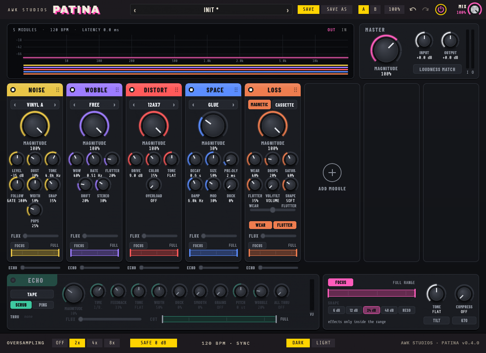

# PATINA

**Colour rack: 14 lo-fi, motion, space and tone modules, up to 8 at a time in any order, plus an ECHO strip.**



PATINA is a rack of character effects. Add up to eight modules in any order, drag them around, and every module can FOCUS on a frequency range, drift on its own (FLUX) and send its sound into the ECHO's repeats.

## Features

- **14 modules:** NOISE, DIGITAL, LOSS (MAGNETIC tape or CODEC), CHOP, WOBBLE, SPACE, CHORUS, VARISPEED, REVERSE, DISTORT, TAME, FILTER, WIDTH, COMPRESS.
- **FOCUS / CUT** per module: work on only one frequency range, or remove everything outside it.
- **FLUX:** each module's main knob drifts around by itself.
- **ECHO SEND:** every repeat goes back through the module, so the echoes degrade, wobble or distort more each trip.
- **Master:** MAGNITUDE (scales every module at once), TONE, COMPRESS (6 VISE models), LOUDNESS MATCH, MIX, SAFE.
- Dark or light look (footer).
- 70 factory presets.

## Install

Windows 64-bit, VST3. Built and tested in FL Studio.

1. Download `Patina-v0.3.3-win64.zip` from [Releases](../../releases/latest).
2. Copy `Patina.vst3` into `C:\Program Files\Common Files\VST3\`.
3. Copy the files in `presets` into `Documents\Awknode\Presets\Patina\` (create the folder if it doesn't exist).
4. Rescan plugins in your DAW.

## Using it

Every awk studios plugin has the same top strip: preset browser, A/B, undo/redo, power (bypass) and a global MIX. Knobs drag up and down (hold Ctrl or Shift for fine control), scroll to nudge, and double-click to reset. **SAFE** in the footer is an output limiter that keeps the plugin from going over 0 dBFS; it's on by default.

The full control reference is in the **[manual](docs/MANUAL.md)**.

## Build from source

You'll need Docker. Clone this repo next to the [nice-plug-awk](https://github.com/awknode/nice-plug-awk) framework fork, then run the build script:

```sh
git clone https://github.com/awknode/patina
git clone -b awk-studios https://github.com/awknode/nice-plug-awk
cd patina && ./build.sh
```

The plugin lands in `target/bundled/Patina.vst3`.

## License

GPL-3.0. See [LICENSE](LICENSE). Built with [nice-plug](https://codeberg.org/RustAudio/nice-plug).

---

More awk studios plugins: [VISE](https://github.com/awknode/vise) · [SALVE](https://github.com/awknode/salve) · [HOIST](https://github.com/awknode/hoist) · [KILN](https://github.com/awknode/kiln) · [CHOPSHOP](https://github.com/awknode/chopshop) · [THROWBACK](https://github.com/awknode/throwback) · [THROW FX](https://github.com/awknode/throw-fx) · [KICKNULL](https://github.com/awknode/kicknull) · [ALLEYVERB](https://github.com/awknode/alleyverb) · [WAVETAG](https://github.com/awknode/wavetag) · [dBCOMP](https://github.com/awknode/dbcomp) · [dBVOX](https://github.com/awknode/dbvox)

### Dice (random patch)
The dice button next to the preset box rolls a random patch. **Shift+click** nudges every control a little instead. **Undo** takes either back. Levels, mix, oversampling, the safety limiter and bypass are never touched, so a roll can't blast you or go silent.
